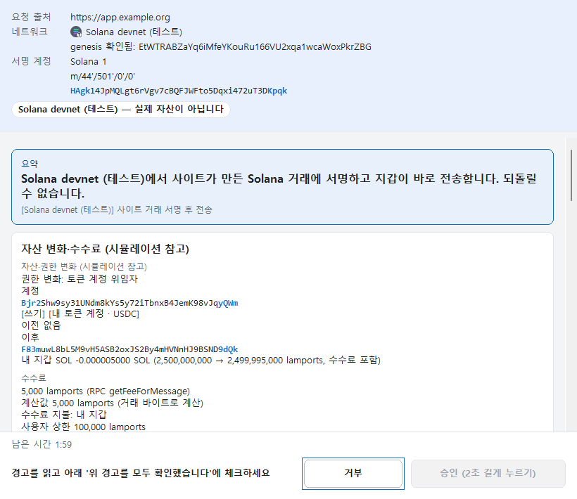
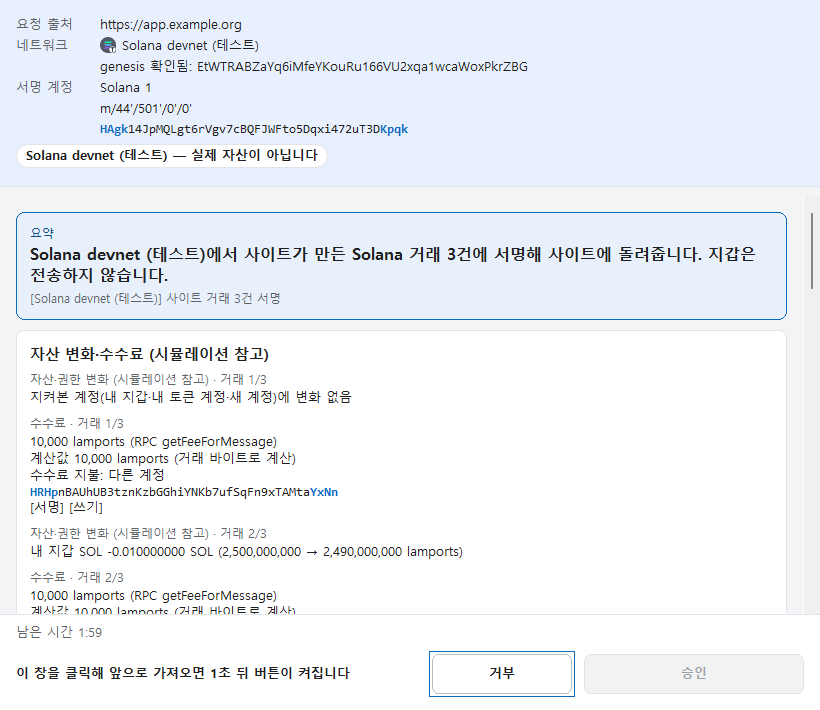

# Your Wallet

**한국어** · **[English](#english)**

Windows 11 PC 한 대에서 쓰는 개인용 멀티체인 지갑입니다. 키와 서명은 브라우저 밖의 데스크톱 앱(또는 YubiKey)이 맡고,
Chrome 확장은 dApp 요청을 앱으로 전달만 합니다. 서명할 데이터는 앱이 직접 해석해 별도 창에 보여 주고, EVM·Solana·
Bitcoin·Zcash·HyperCore를 한 앱에서 다룹니다. 소스로만 공개하며, 각자 자기 PC에서 직접 빌드해 설치합니다.

<p align="center">
  
  
</p>

> **상태:** 계획한 기능을 모두 구현했고 저장소 게이트(`scripts/check.ps1`)를 전부 통과합니다. 단계별 수동 검증
> ([docs/acceptance/](docs/acceptance/))은 아직 진행 중입니다. 제3자 보안 감사를 받지 않은 개인 프로젝트이니, 처음에는
> 잃어도 괜찮은 소액으로 시작하세요. 미리 빌드한 실행 파일은 배포하지 않습니다.

## 왜 Your Wallet인가

| | 일반적인 브라우저 확장 지갑 | Your Wallet |
|---|---|---|
| 키가 있는 곳 | 브라우저 확장의 저장소 | 브라우저 밖 데스크톱 앱의 암호화 vault, 또는 YubiKey 안 |
| 서명을 확인하는 곳 | 브라우저 확장 팝업 | 항상 위에 뜨는 별도 Windows 창 — 서명할 바이트를 앱이 직접 해석하고, EVM 거래와 Solana dApp 거래는 시뮬레이션까지 |
| 하드웨어 서명 | 별도 하드웨어 지갑 | YubiKey 5로 EVM·Bitcoin·Zcash·Solana 서명, 여러 장을 서로의 백업으로 |
| 체인 | 지갑마다 다름 | EVM 7개 + 직접 추가, Solana(dApp 거래 포함), Bitcoin(주소 형식 4가지), Zcash, HyperCore |
| 배포 | 스토어에서 받는 바이너리 | 소스만 — 직접 빌드, 의존성 고정, 확장은 npm 패키지 0개 |

**1. 키가 브라우저와 분리됩니다.** Chrome 확장에는 비밀이 하나도 없고, 권한도 `nativeMessaging`·`storage` 두 가지뿐입니다.
키·복구 단어·서명은 데스크톱 앱에만 있고, 확장과 앱은 현재 Windows 사용자 전용 통로로 이어지며 연결 전에 상대가 설치된 지갑
앱인지 확인합니다. 웹페이지나 다른 확장은 키에 닿을 수 없고, 어떤 요청이든 앱의 승인 창에서 직접 승인해야 서명됩니다.

**2. 보이는 그대로 서명합니다.** 승인 창은 사이트가 붙인 설명이 아니라, 앱 코어가 서명할 바이트를 직접 해석한 결과를
보여 줍니다. EVM 거래는 `eth_simulateV1`, Solana dApp 거래는 `simulateTransaction`으로 자산 변화를 미리 보여 주고,
시뮬레이션을 하지 못하면 고위험으로 표시합니다. 승인은 그 바이트·체인·계정·시뮬레이션 결과·만료 시각에 묶인 1회용이라
다른 요청에 쓸 수 없고, 서명한 뒤에는 결과를 한 번 더 검증합니다.
- **경고:** 무제한 승인, `setApprovalForAll`, 일반 주소(EOA)에 주는 승인, 자산을 보내기만 하고 받는 것이 없는 거래, 가짜
  전송 로그, 숨은 추가 유출, 해석할 수 없는 호출과 서명 데이터. Solana는 위임(Approve)·권한 변경·계정 닫기·모르는 프로그램.
- **차단:** 서명 데이터(EIP-712)의 chainId 불일치, 로그인 메시지(SIWE)의 도메인 불일치, EVM 수수료 상한 초과, 컨트랙트 배포와
  EIP-7702 같은 지원하지 않는 거래 형식. 아무 데이터에나 서명하게 하는 `eth_sign`은 아예 지원하지 않습니다.

**3. 실수 클릭과 클릭 유도를 막습니다.** 승인 창은 항상 위에 뜨고 처음 포커스는 `거부`에 있습니다. `승인`은 창이 앞에 온
뒤 1초가 지나야 켜지고, 그 전에 들어온 클릭·키 입력은 대기를 처음부터 다시 시작합니다. 위험한 요청은 확인 체크와 2초
누르기가 필요하고 Enter로는 승인되지 않습니다. 창에 보내지거나 흉내 낸 Enter 키로는 승인되지 않습니다(같은 PC의
악성 프로그램을 막는 장치는 아닙니다).

**4. YubiKey를 하드웨어 서명 장치로.** 'YubiKey 지갑'(복구 단어를 PC에 저장하지 않는 지갑)을 만들면 복구 단어에서 고른
키는 YubiKey 5에만 들어가고 PC에는 공개키만 남습니다. 서명할 때마다 카드가 PIN(기억해 두지 않음)과, 기본 설정에서는
터치를 요구합니다. EVM·Bitcoin·Zcash는 OpenPGP secp256k1, Solana는 PIV Ed25519로
서명하며, HyperCore·WalletConnect·Solana dApp 거래도 YubiKey로 서명합니다. 같은 복구 단어의 키를 최대 8장의 카드에 넣어
서로의 백업으로 쓰고, 한 카드에 다른 카드 키의 사본과 새 키를 함께 둘 수도 있습니다.

**5. 체인마다 지갑을 바꿀 필요가 없습니다.** EVM 7개와 직접 추가한 EVM 체인, Solana, Bitcoin, Zcash, Hyperliquid HyperCore를
한 앱과 한 복구 단어로 다룹니다. Solana dApp은 연결·메시지 서명에 더해 **거래 서명·전송**(legacy·v0, 주소 조회 테이블, 여러
건 한 번에)까지 되고, EVM과 같은 승인 창·위험 규칙·시뮬레이션을 거칩니다.

**6. 표준 복구.** BIP39 복구 단어와 표준 경로(BIP44/49/84/86, Solana `m/44'/501'`)를 쓰므로 다른 지갑에서도 같은 주소를
복구할 수 있습니다. 복구 단어를 여러 개 두거나 개인키만 가져와 쓸 수도 있습니다.

**7. 주소 오염·피싱 대비.**
- 주소록·내 계정·보낸 내역의 주소와 앞뒤만 비슷한 주소를 경고하고 확인을 받습니다(앱 보내기, dApp, WalletConnect).
- 승인·연결 창, 보내기, 받기, 주소록에서는 주소를 자르지 않고 전체로 보여 줍니다. 접두부 뒤 4자와 끝 4자를 강조하되,
  가운데까지 확인하라고 안내합니다.
- 보이지 않는 문자나 글자 방향을 바꾸는 유니코드 문자는 `[U+XXXX]`로 드러내 보입니다.
- 받은 내역은 기본으로 꺼져 있습니다. 켜도 0원·먼지 입금은 숨기고, 보낸 사람 주소는 복사할 수 없습니다.

**8. 비밀은 화면과 클립보드에도 남기지 않습니다.** 복구 단어·개인키 창은 화면 캡처에서 제외되며, 제외할 수 없으면 아예
보여 주지 않습니다. 비밀 복사는 기본으로 꺼져 있고, 켜도 클립보드 기록·클라우드 동기화에서 빠지며 그대로 두면 30초 뒤 지워집니다.
자리를 비운 지 10분(1–60분 조절), Windows 잠금, 절전 때 자동으로 잠깁니다. vault는 Argon2id(256 MiB) +
XChaCha20-Poly1305로 암호화합니다.

**9. 프라이버시.** 텔레메트리, 충돌 보고 업로드, 지갑 자체 서버가 없습니다. 앱이 연결하는 곳은 내가 설정한 RPC와 기능에
필요한 곳뿐입니다: Bitcoin 주소 조회(기본 mempool.space의 Esplora, 바꿀 수 있음), HyperCore(Hyperliquid 공식 API), 켰을
때의 WalletConnect 릴레이와 AI 설명 공급자. 로그에는 비밀번호·복구 단어·키·API 키·RPC 주소·금액·사이트 주소를 남기지
않습니다(내 주소와 거래 해시는 남을 수 있습니다).

**10. 기존 dApp과 호환.** 기본 이름(`Your Wallet (EVM)`·`Your Wallet (Solana)`) 외에 MetaMask·Rabby·Phantom·UniSat·Xverse처럼
보이는 호환 모드가 있고, 확장 없이 WalletConnect v2(QR·링크)로도 연결합니다.

**11. 검토할 수 있는 공급망.** Rust 외부 크레이트는 54개이고 `Cargo.lock` 체크섬으로 고정해 `--locked`로 빌드합니다.
크레이트마다 의존성 허용 목록이 있어 새 크레이트는 검사 스크립트가 막고, 확장은 npm 패키지를 하나도 쓰지 않습니다. 서명·해시·
암호화 같은 암호 기본 요소는 직접 구현하지 않고 널리 쓰이는 크레이트를 고정 버전으로 씁니다. `unsafe`는 Windows API를 감싸는
크레이트 하나에서만 허용하고, 게이트는 1,400개가 넘는 테스트와 fuzz-lite 대상 22개, 개인정보 검사, 확장 정적 감사를 매번
실행합니다.

## 화면

<p align="center">
  
  
</p>
<p align="center">
  
  
</p>
<p align="center">
  
  
</p>

모든 화면은 시험용 값입니다. 전체 화면 투어: [docs/screenshots](docs/screenshots/README.md).

## 기능

**체인**
- **EVM** — Ethereum, Arbitrum One, Base, BNB Smart Chain, Robinhood Chain, HyperEVM, Sepolia, 그리고 직접 추가한
  EVM 체인(chainId 확인, 처음 쓸 때 genesis 해시를 고정하고 연결할 때마다 다시 확인). 네이티브 코인과 ERC-20 토큰(기본 목록 +
  직접 추가, 숨기기 — 직접 추가한 토큰은 늘 `(미확인)` 표시), 체인별 수수료 상한(Base L1 데이터 수수료 포함), 속도 올리기·취소.
- **Solana** — SOL과 허용 목록의 USDC/USDT(클래식 Token 프로그램) 보내기, mainnet·devnet. 받는 사람의 토큰 계정이 없으면
  같은 거래에서 만듭니다.
- **Bitcoin** — 네이티브 세그윗(`bc1q`, 기본), 탭루트(`bc1p`), 호환 세그윗(`3…`), 레거시(`1…`), mainnet·testnet4. 기본은
  계정마다 고정 주소 하나(UniSat·Xverse 방식), 원하면 받을 때마다 새 주소(HD). 입력 금액을 이전 거래 원본의 해시로 검증하므로
  주소 조회 서버를 믿지 않습니다. 전액 보내기, RBF 수수료 올리기, UTXO 동결.
- **Zcash** — 일반(transparent) 주소만. t-주소, TEX, 통합 주소(UA)의 일반 수신자로 보낼 수 있습니다(v5 거래, ZIP 244 서명,
  ZIP 317 수수료).
- **HyperCore**(Hyperliquid) — EVM과 같은 키로 잔액, 전송, 현물↔선물, Arbitrum 출금, HyperEVM↔HyperCore 이동. 트레이딩은
  없습니다.

**키**
- OS 난수로 24단어 생성과 백업 확인, 12·15·18·21·24단어 가져오기(passphrase 선택), 복구 단어 최대 8개(각각 EVM·Solana·
  Bitcoin·Zcash 계정).
- 개인키 가져오기(EVM hex, Solana base58/JSON, Bitcoin WIF, Zcash WIF/hex, 체인마다 15개까지)와 개인키로만 시작하는 지갑.
- **YubiKey 5** — EVM·Bitcoin·Zcash는 OpenPGP secp256k1(펌웨어 5.2.3 이상, 카드당 키 2개, 탭루트 제외), Solana는 PIV
  Ed25519(펌웨어 5.7.4 이상, 5.7.0–5.7.3은 경고 후 시도). 복구 단어에서 키를 넣어 최대 8장의 카드에 백업하거나(다른 카드에
  이미 있는 키는 사본으로 함께 넣음) 복구 단어 없이 카드를 연결합니다. PIN 바꾸기·슬롯 구성 바꾸기·비우기를 앱에서 합니다.
- vault: Argon2id(256 MiB) + XChaCha20-Poly1305, 비밀번호는 ASCII 12–128자. 데이터 폴더는 현재 사용자·SYSTEM·Administrators만
  열 수 있고, 낮은 무결성 프로세스(예: 브라우저 샌드박스)는 읽지 못합니다.

**서명과 dApp**
- 승인 창: 코어가 직접 해석한 내용, 시뮬레이션(EVM `eth_simulateV1`, Solana `simulateTransaction`), 위험 규칙(EVM E01–E43,
  Solana X01–X20), 1회용 승인, 1초 대기·2초 누르기.
- Chrome 확장: EVM은 EIP-1193/EIP-6963, Solana는 Wallet Standard(Phantom 호환 모드 포함). Bitcoin은 확장 팝업에서 UniSat·Xverse
  호환 모드를 켰을 때만 페이지에 보이며, 연결과 **메시지 서명(BIP137·BIP322, 소유 증명)만** 됩니다.
- **Solana dApp 거래** — `signTransaction`, `signAllTransactions`(최대 32건을 창 하나·승인 한 번으로), `signAndSendTransaction`.
  - legacy·v0 거래와 주소 조회 테이블(ALT), 사이트가 먼저 넣은 서명, 지갑이 아닌 수수료 지불자를 지원합니다. 지갑은
    blockhash를 바꾸지 않고 내 서명 칸만 채웁니다.
  - System·Token·Token-2022·ATA·ComputeBudget·Memo 명령을 해석해 보여 줍니다. 해석하지 못한 프로그램은 막지 않고
    고위험으로 경고하며, 판단은 사용자가 합니다. 위임(Approve), 권한 변경, 다른 주소로 계정 닫기, Token-2022의
    PermanentDelegate·TransferHook도 고위험입니다.
  - durable nonce 거래는 서명만 됩니다(전송은 거부). 지갑이 수수료를 낼 때 상한(기본 100,000 lamports)을 넘으면 고위험입니다.
  - 시뮬레이션은 내 RPC가 답한 참고 정보입니다. 서명만 해 준 거래는 지갑이 보내지 않으므로 활동에 남지 않습니다.
- WalletConnect v2(EVM만): `wc:` 링크를 붙여넣거나 스크린샷·이미지 파일의 QR을 읽어 연결합니다. 켜려면
  `dashboard.reown.com`에서 받은 **내 Reown Project ID**가 필요합니다(기본값 없음). 확장과 같은 승인 창·위험 규칙·시뮬레이션을
  쓰고, 세션은 앱을 다시 시작해도 이어집니다.
- 선택 기능 AI 설명: EVM dApp 요청(`eth_sendTransaction`·`personal_sign`·`eth_signTypedData_v4`)을 AI가 풀어 설명합니다.
  기본 꺼짐, OpenAI 호환 엔드포인트(OpenAI·Claude·OpenRouter·Ollama·LM Studio 등)와 내 API 키. 위험 판단과 승인에는 영향을
  주지 않습니다.

**일상 기능**
- 보내기 양식: 금액 칸 옆에 보낼 수 있는 잔액과 `최대` 버튼, 주소록 즐겨찾기 칩(EVM·Solana·Bitcoin).
- 주소록: EVM 주소 하나는 모든 EVM 체인 공용, Solana는 mainnet·devnet 공용, Bitcoin은 네트워크별.
- 이 지갑이 보낸 거래 활동과 받은 내역(선택). 주소·해시를 누르면 복사, 체인별 블록 탐색기 링크(설정에서 변경 가능).
- 15초마다 잔액 갱신(EVM·Solana·HyperCore, 창이 숨겨지면 멈춤).
- QuickNode 주소 하나로 모든 체인 RPC 설정(Alchemy·직접 입력도 가능), 지갑 초기화(파일을 지우지 않고 옆으로 옮김).

**하지 않는 것:** Windows 11 외 OS·모바일, 앱 안의 스왑·트레이딩, Bitcoin dApp의 거래 서명(PSBT), 멀티시그, Zcash 차폐 주소,
지갑 앱의 Token-2022·NFT 보내기. RPC는 직접 준비해야 합니다(QuickNode·Alchemy 무료 플랜으로 충분).

## 설치

준비: Windows 11 x64와 Chrome. 소스는 `git clone` 또는 GitHub **Code → Download ZIP**으로 받습니다.

1. 저장소 폴더의 **`install.cmd`** 를 더블클릭합니다. 소스를 빌드하고(처음에는 몇 분) `%LOCALAPPDATA%\Programs\YourWallet`에
   설치합니다(관리자 권한 불필요). Rust나 Visual Studio C++ 빌드 도구가 없으면 무엇이 없는지 보여 주고, 동의할 때만
   winget으로 설치합니다.
2. Chrome `chrome://extensions` → 개발자 모드 → **압축해제된 확장 프로그램 로드** →
   `%LOCALAPPDATA%\Programs\YourWallet\extension` 선택(경로는 설치 후 클립보드에 있고, 앱의 설정 → 브라우저·정보에도 안내가 있습니다).
3. 시작 메뉴에서 **Your Wallet**을 열고 지갑을 만들거나 가져온 뒤, 완료 화면에서 QuickNode 주소를 넣어 RPC를 연결합니다.

업데이트: `git pull` → `install.cmd` → 확장 카드의 새로고침. 제거: `uninstall.cmd`(지갑 데이터
`%LOCALAPPDATA%\YourWallet`은 남깁니다). 설치 스크립트가 저장소 폴더의 *Low* 무결성 레이블을 경고하면
`icacls "<저장소 폴더>" /setintegritylevel (OI)(CI)M`으로 지우거나, 알고 계속하려면 확인합니다.

실제 자산을 넣기 전에 [첫 사용 체크리스트](docs/first-use-checklist.ko.md)를 따르세요. 자세한 설치·문제 해결은
[docs/install.ko.md](docs/install.ko.md).

## 개발

전제([spec/01](spec/01-repo-build.md)): Windows 11 x64, rustup과 고정 툴체인(`rust-toolchain.toml`, Rust 1.95.0),
Visual Studio Build Tools(C++ 데스크톱 개발), Node.js 22+(검사용, npm 패키지 없음), Git, PowerShell 5.1 또는 7.

```powershell
cargo build --release --locked
powershell -NoProfile -ExecutionPolicy Bypass -File scripts/check.ps1 -Offline   # 저장소 게이트
```

게이트는 fmt, 의존성 허용 목록, clippy, 테스트, fuzz-lite, 빌드, 확장·스크립트 테스트, 개인정보 검사, 확장 정적 감사,
아이콘 검사를 차례로 실행합니다. `cargo update`는 쓰지 않고 새 크레이트는 더하지 않습니다. AI 코딩 에이전트와 작업한다면
먼저 [AGENTS.md](AGENTS.md)를 읽게 하세요(저장소 규칙, 명령, 하면 안 되는 일).

## 보안 범위

방어 대상과 비목표는 [spec.md](spec.md) §2에 있습니다. 범위 안: 보이는 것과 다른 서명, 악성 사이트와 WalletConnect 상대,
같은 PC의 다른 사용자, 키 분실, 버전 간 데이터 손실. 내 Windows 사용자 권한으로 도는 악성코드, 관리자·커널 장악, PC에 대한
물리 공격은 범위 밖입니다 — PC가 장악되면 지갑도 장악된 것으로 봅니다(YubiKey 지갑을 쓰면 키 자체는 PC 밖에 남습니다). 올바르게
표시된 악성 거래를 직접 승인하는 것도 막을 수 없습니다.

알아 둘 한계:
- **감사:** 제3자 보안 감사를 받지 않았습니다. [2026-11-01 내부 보안 검토](docs/security-review-20261101.md)가 있고, 그 뒤에
  더한 기능(YubiKey, WalletConnect, Zcash, 복구 단어 여러 개, Solana dApp 거래)은 단계마다 코드 검토를 거쳤습니다.
- **용도:** 한 사람이 자기 PC에서 쓰는 지갑입니다. 큰 금액을 오래 보관하는 용도가 아니니, 잃어도 되는 금액만 두세요.
- **RPC 신뢰:** 설정한 RPC 공급자를 믿습니다. 잔액·확인·시뮬레이션은 RPC가 답한 값이고, 확인 1번을 최종으로 봅니다. RPC가
  `eth_simulateV1`을 지원하지 않으면 모든 EVM 거래가 고위험으로 표시됩니다. RPC가 화면을 속일 수는 있어도 서명하는 바이트는
  바꾸지 못합니다.
- **Solana dApp 거래:** 모르는 프로그램 호출은 경고만 하고 막지 않으므로 마지막 판단은 사용자 몫입니다. 서명만 해 준 거래는
  사이트가 만료 전에 언제든 보낼 수 있고, durable nonce 거래에는 만료가 없습니다. 가장 최근에 더한 기능이라 실제 네트워크
  검증은 이어지는 중입니다.
- **YubiKey:** 카드에는 화면이 없어 무엇에 서명하는지는 PC 창으로만 확인합니다. PC가 장악되면 다른 내용에 대한 터치를 받아낼
  수 있습니다. 키는 등록할 때 PC에서 복구 단어로 한 번 계산해 넣습니다(카드 안에서 만들지 않음). 터치를 "15초 유지"로 두면
  그동안의 추가 서명에는 터치가 필요 없습니다. 복구 단어 없이 연결하거나 "가져오기 없이 등록"한 카드는 카드에 이미 있는
  터치 정책을 그대로 쓰며, 그 정책이 "터치 없음"일 수도 있습니다.
- **YubiKey와 같은 복구 단어:** 카드에 넣은 키의 복구 단어가 이 PC의 vault에도 저장되어 있으면 YubiKey는 보안 이득이
  없습니다(같은 키를 PC에서도 만들 수 있음, 마법사가 경고합니다). 키를 PC 밖에 두려면 YubiKey 지갑을 새로 만들고 복구
  단어는 종이에만 두세요.
- **호환 모드**는 가능한 범위의 흉내입니다. 같은 계열의 실제 확장(MetaMask·Rabby·Phantom)은 꺼 두세요.
- **비밀번호:** 시도 횟수 제한이 없어 오프라인 추측은 Argon2 비용으로만 막습니다. 비밀번호를 바꾸면 암호화 키(DEK)도
  새로 만들어 바꾼 뒤의 내용은 예전 사본으로 열 수 없지만, 바꾸기 전의 vault 사본은 예전 비밀번호로 계속 열리고 그때의
  복구 단어·키를 드러냅니다(약한 예전 비밀번호는 나중에 오프라인으로 풀릴 수 있습니다). 2026-11-13 이전 버전에서 바꾼
  비밀번호는 키를 그대로 두었으니 한 번 더 바꾸세요. 예전 비밀번호와 사본이 함께 샜다면 새로 만든 별도 지갑으로 자산을
  옮기세요. 디스크에 남을 수 있는 메모리 흔적(최대 절전·페이지 파일)에 대비해
  BitLocker를 권합니다.

## 문서

AI·코딩 에이전트용: [AGENTS.md](AGENTS.md)(코딩 에이전트 작업 안내) · [llms.txt](llms.txt)(LLM용 문서 색인) ·
[docs/dapp-integration.md](docs/dapp-integration.md)(dApp 연동 참고: 제공자 API, 메서드, 오류 코드).

| 문서 | 내용 |
|---|---|
| [spec.md](spec.md) | 목표, 위협 모델, 결정 사항, 아키텍처 |
| [spec/](spec/) | 01 저장소·빌드 · 02 키·vault · 03 EVM · 04 앱 UI · 05 브라우저 · 06 AI 설명 · 07 Solana · 08 Bitcoin · 09 테스트 · 10 YubiKey · 11 HyperCore · 12 Zcash · 13 WalletConnect |
| [docs/install.ko.md](docs/install.ko.md) | 설치·업데이트·제거, 첫 실행, 파일 위치, 문제 해결 |
| [docs/first-use-checklist.ko.md](docs/first-use-checklist.ko.md) | 첫 실제 사용 체크리스트 |
| [docs/recovery-guide.ko.md](docs/recovery-guide.ko.md) | 백업·복구 안내 |
| [docs/screenshots/](docs/screenshots/README.md) | 화면 투어(시험용 값) |
| [docs/security-review-20261101.md](docs/security-review-20261101.md) | 보안 검토와 처리 결과 |
| [docs/acceptance/](docs/acceptance/) | 기능·단계별 인수 기록 |
| [docs/ux-review-20261109.md](docs/ux-review-20261109.md) | 최근 UI/UX 검토 |
| [docs/android-feasibility-20261107.md](docs/android-feasibility-20261107.md) | Android 이식 타당성(조사만, 계획 없음) |

## 라이선스

누구나 쓸 수 있습니다. [Apache License 2.0](LICENSE-APACHE) 또는 [MIT License](LICENSE-MIT) 중 원하는 쪽을 골라 따르면 됩니다
(`Apache-2.0 OR MIT`). 어떤 보증도 없이 "있는 그대로" 제공됩니다 — 자금 손실을 포함한 결과는 쓰는 사람의 책임입니다.

---

## English

[↑ 한국어](#your-wallet)

A personal multi-chain wallet for one Windows 11 PC. Keys and signing live in a desktop app outside the browser (or on
a YubiKey); the Chrome extension only forwards dApp requests to it. The app decodes what you are about to sign and
shows it in its own window, and one app covers EVM, Solana, Bitcoin, Zcash and HyperCore. Published as source only —
you build and install it yourself.

> **Status:** every planned feature is implemented and the full repository gate (`scripts/check.ps1`) passes;
> manual per-milestone verification ([docs/acceptance/](docs/acceptance/)) is still in progress. It is a personal
> project with no third-party security audit, so start with an amount you can afford to lose. No prebuilt binaries
> are published.

### Why Your Wallet

| | Typical browser-extension wallet | Your Wallet |
|---|---|---|
| Where keys live | Browser extension storage | Encrypted vault of a desktop app outside the browser, or inside a YubiKey |
| Where you review a signature | Extension popup | A separate always-on-top Windows window — the app decodes the exact bytes, and simulates EVM transactions and Solana dApp transactions |
| Hardware signing | A separate hardware wallet | A YubiKey 5 signs for EVM, Bitcoin, Zcash and Solana; several cards back each other up |
| Chains | Varies by wallet | 7 EVM chains + your own, Solana (dApp transactions included), Bitcoin (4 address types), Zcash, HyperCore |
| Distribution | Store binary | Source only — you build it; pinned dependencies; zero npm packages in the extension |

**1. Keys are separated from the browser.** The Chrome extension holds no secret at all, and its only permissions are
`nativeMessaging` and `storage`. Keys, recovery phrases and signing stay in the desktop app, which the extension reaches
over a channel private to your Windows user after checking that the other end is the installed wallet app. Web pages
and other extensions can't reach the keys, and nothing is signed until you approve it in the app's own window.

**2. You sign what you see.** Approval windows show what the app's core decoded from the bytes being signed, never the
site's own description. EVM transactions are simulated with `eth_simulateV1` and Solana dApp transactions with
`simulateTransaction` to preview balance changes; if simulation isn't possible, the request is marked high risk. Each
approval is single-use and bound to those bytes, the chain, the account, the simulation result and an expiry time, and
every signature is checked again after signing.
- **Warned:** unlimited approvals, `setApprovalForAll`, approvals to a plain address (EOA), transactions that send
  assets and receive nothing, fake transfer logs, hidden extra outflows, calls and signing data the wallet can't
  decode. On Solana: delegation (Approve), authority changes, closing accounts and unknown programs.
- **Blocked:** an EIP-712 chainId mismatch, a sign-in (SIWE) domain that doesn't match the site, an EVM fee above the
  cap, contract deployment and unsupported transaction types such as EIP-7702. `eth_sign`, which signs arbitrary data,
  is not supported at all.

**3. Built against misclicks and click-jacking.** The approval window stays on top and opens with focus on Reject. The
approve button arms only a second after the window comes to the front, and any click or key press before that restarts
the wait. Risky requests need a confirmation tick and a 2-second hold, and Enter never approves them. A posted or
injected Enter key never approves (a consistency check, not a defence against malware on the PC).

**4. A YubiKey as your hardware signer.** With a "YubiKey wallet" (one that never stores the recovery phrase on the
PC), keys from your phrase go only onto a YubiKey 5 and the PC keeps only the public keys. Every signature needs the
PIN (never cached) and, by default, a touch. EVM, Bitcoin and Zcash use OpenPGP
secp256k1; Solana uses PIV Ed25519. HyperCore, WalletConnect and Solana dApp transactions can be signed with the card
too. Keys from the same phrase can go on up to 8 cards as backups of each other, and one card can hold copies of
another card's keys alongside new ones.

**5. One wallet for many chains.** Seven EVM chains plus any you add, Solana, Bitcoin, Zcash and Hyperliquid HyperCore
from one app and one recovery phrase. Solana dApps can connect, request message signatures and now **sign or send
transactions** (legacy and v0, address lookup tables, several at once) through the same approval window, risk rules and
simulation as EVM.

**6. Standard recovery.** BIP39 phrases and standard paths (BIP44/49/84/86, Solana `m/44'/501'`) mean other wallets
recover the same addresses. Several recovery phrases and key-only accounts are supported.

**7. Address-poisoning and phishing defences.**
- Addresses that only share the start and end with an address-book entry, one of your accounts or a past recipient
  are flagged and need confirmation (app sends, dApps and WalletConnect).
- Approval and connect windows, send, receive and the address book show addresses whole, never shortened. The 4
  characters after the prefix and the last 4 are emphasized, with a reminder to check the middle too.
- Invisible characters and Unicode direction overrides are revealed as `[U+XXXX]`.
- Received history is off by default. When on, zero-value and dust deposits are hidden and senders can't be copied.

**8. Secrets stay off the screen and the clipboard.** Recovery-phrase and private-key windows are excluded from screen
capture, and if exclusion fails they show nothing. Copying secrets is off by default; when turned on, the copy is kept
out of clipboard history and cloud sync and cleared after 30 seconds if left untouched. The wallet locks after 10 idle minutes
(adjustable from 1 to 60), on Windows lock and on sleep. The vault is encrypted with Argon2id (256 MiB) +
XChaCha20-Poly1305.

**9. Privacy.** No telemetry, no crash upload, no wallet server. The app talks only to the RPC you configure and to
services a feature needs: Bitcoin address lookups (mempool.space's Esplora by default, changeable), HyperCore (the
official Hyperliquid API), and — when you turn them on — the WalletConnect relay and your AI provider. Logs never
contain passwords, recovery phrases, keys, API keys, RPC URLs, amounts or site origins (your addresses and transaction
hashes may appear).

**10. Works with existing dApps.** Besides the default names (`Your Wallet (EVM)`, `Your Wallet (Solana)`) there are
compatibility modes that look like MetaMask, Rabby, Phantom, UniSat or Xverse, and WalletConnect v2 (QR or link)
without the extension.

**11. A supply chain you can review.** There are 54 third-party Rust crates, pinned with checksums in `Cargo.lock` and
built with `--locked`. A per-crate dependency allowlist makes a check script reject any new crate, and the extension
uses no npm packages. Cryptographic primitives (signatures, hashes, encryption) are never hand-rolled; they come from
widely used crates at pinned versions. `unsafe` is allowed only in the one crate that wraps the Windows API, and the
gate runs more than 1,400 tests, 22 fuzz-lite targets, a privacy scan and an extension static audit every time.

### Screenshots

See the images above and the full [screen tour](docs/screenshots/README.md) (Korean UI, test values only).

### Features

**Chains**
- **EVM** — Ethereum, Arbitrum One, Base, BNB Smart Chain, Robinhood Chain, HyperEVM, Sepolia, plus any EVM chain you
  add (chainId checked, genesis hash pinned on first use and re-checked on every connection). Native coins and ERC-20
  tokens (built-in list + your own, hide/show — tokens you add are always marked unverified), per-chain fee caps (Base
  L1 data fee included), speed-up and cancel.
- **Solana** — send SOL and allow-listed USDC/USDT (classic Token program) on mainnet and devnet. The recipient's token
  account is created in the same transaction if needed.
- **Bitcoin** — native segwit (`bc1q`, default), taproot (`bc1p`), nested segwit (`3…`) and legacy (`1…`) on mainnet
  and testnet4; one fixed address per account by default (UniSat/Xverse style) or a new address per receive (HD).
  Input amounts are verified against the hash of each previous transaction, so the address indexer isn't trusted.
  Send-max, RBF fee bumps and UTXO freezing.
- **Zcash** — transparent addresses only (send to t-addr, TEX and the transparent receiver of a unified address; v5
  transactions, ZIP 244 signing, ZIP 317 fees).
- **HyperCore** (Hyperliquid) — with the same key as EVM: balances, transfers, spot↔perp, withdraw to Arbitrum,
  HyperEVM↔HyperCore moves. No trading.

**Keys**
- 24-word generation from the OS RNG with a backup check; import 12/15/18/21/24 words with an optional passphrase; up to
  8 phrases, each with EVM, Solana, Bitcoin and Zcash accounts.
- Private-key import (EVM hex, Solana base58/JSON, Bitcoin WIF, Zcash WIF/hex; up to 15 per chain) and key-only wallets.
- **YubiKey 5** — OpenPGP secp256k1 for EVM/Bitcoin/Zcash (firmware 5.2.3+, two keys per card, no taproot) and PIV
  Ed25519 for Solana (firmware 5.7.4+; 5.7.0–5.7.3 is tried after a warning). Enrol keys from your words onto up to 8
  cards (a key another card already holds is copied onto the new one), or connect a card without words. PIN changes,
  slot reconfiguration and clearing are built in.
- Vault: Argon2id (256 MiB) + XChaCha20-Poly1305, ASCII password of 12–128 characters. The data folder is open only to
  your user, SYSTEM and Administrators, and low-integrity processes (such as a browser sandbox) can't read it.

**Signing and dApps**
- Approval windows: the core's own decoding, simulation (EVM `eth_simulateV1`, Solana `simulateTransaction`), risk
  rules (EVM E01–E43, Solana X01–X20), single-use approvals, 1 s arm delay and 2 s hold.
- Chrome extension: EIP-1193/EIP-6963 for EVM, Wallet Standard for Solana (plus a Phantom compatibility mode). Bitcoin
  appears on pages only after you pick the UniSat or Xverse compatibility mode in the extension popup, and supports
  connecting and **message signatures only** (BIP137 and BIP322, proof of ownership).
- **Solana dApp transactions** — `signTransaction`, `signAllTransactions` (up to 32 in one window with one approval)
  and `signAndSendTransaction`.
  - Legacy and v0 transactions with address lookup tables, signatures the site has already added, and a fee payer other
    than the wallet. The wallet never changes the blockhash and fills only its own signature slot.
  - System, Token, Token-2022, ATA, ComputeBudget and Memo instructions are decoded and shown. Programs the wallet
    can't decode are not blocked but flagged high risk, and the call is yours. Delegation (Approve), authority changes,
    closing an account to another address, and Token-2022 PermanentDelegate/TransferHook are high risk too.
  - Durable-nonce transactions can be signed but not sent. A fee above the cap (100,000 lamports by default) is high
    risk when the wallet pays it.
  - Simulation is reference information from your RPC. Sign-only transactions are not sent by the wallet, so they
    don't appear in activity.
- WalletConnect v2 (EVM only): paste a `wc:` link or read the QR from a screenshot or image file. It needs **your own
  Reown Project ID** from `dashboard.reown.com` (there is no default). It uses the same approval window, risk rules and
  simulation as the extension, and sessions survive restarts.
- Optional AI explanation of EVM dApp requests (`eth_sendTransaction`, `personal_sign`, `eth_signTypedData_v4`). Off by
  default; any OpenAI-compatible endpoint (OpenAI, Claude, OpenRouter, Ollama, LM Studio, …) with your own API key. It
  never affects risk or approval.

**Everyday**
- Send forms show the spendable balance next to the amount with a `최대` (max) button, and address-book favourites as
  chips (EVM, Solana, Bitcoin).
- Address book: one EVM entry serves every EVM chain, Solana entries cover mainnet and devnet, Bitcoin entries are per
  network.
- Activity for transactions this wallet sent, optional received history. Click an address or hash to copy it;
  per-chain block-explorer links (changeable in settings).
- Balances refresh every 15 s (EVM, Solana, HyperCore; paused while the window is hidden).
- RPC for every chain from one QuickNode URL (Alchemy or manual URLs also work); wallet reset that moves files aside
  instead of deleting them.

**Not included:** other OSes or mobile, swaps or trading inside the app, transaction signing (PSBT) for Bitcoin
dApps, multisig, Zcash shielded addresses, Token-2022 or NFT sends from the wallet app. You bring your own RPC (QuickNode
or Alchemy free plans are enough).

### Install

Requirements: Windows 11 x64 and Chrome. Get the source with `git clone` or GitHub **Code → Download ZIP**.

1. Double-click **`install.cmd`** in the repository folder. It builds from source (a few minutes the first time) and
   installs to `%LOCALAPPDATA%\Programs\YourWallet` — no administrator rights needed. If Rust or the Visual Studio C++
   build tools are missing it says so and installs them with winget only if you agree.
2. In Chrome open `chrome://extensions`, turn on Developer mode, choose **Load unpacked** and select
   `%LOCALAPPDATA%\Programs\YourWallet\extension` (the path is on the clipboard after installing; Settings → 브라우저·정보
   in the app has the same guide).
3. Start **Your Wallet** from the Start menu, create or import a wallet, and paste a QuickNode URL on the finish screen.

Update: `git pull` → `install.cmd` → reload the extension card. Uninstall: `uninstall.cmd` (wallet data in
`%LOCALAPPDATA%\YourWallet` is kept). If the installer warns about a *Low* integrity label on the repository folder,
remove it with `icacls "<repo folder>" /setintegritylevel (OI)(CI)M` or confirm to continue.

Before using real funds, follow the short [first-use checklist](docs/first-use-checklist.ko.md) (Korean). Detailed
install and troubleshooting: [docs/install.ko.md](docs/install.ko.md) (Korean).

### Development

Prerequisites ([spec/01](spec/01-repo-build.md)): Windows 11 x64, rustup with the pinned toolchain
(`rust-toolchain.toml`, Rust 1.95.0), Visual Studio Build Tools (C++ desktop workload), Node.js 22+ (checks only, no npm
packages), Git, PowerShell 5.1 or 7.

```powershell
cargo build --release --locked
powershell -NoProfile -ExecutionPolicy Bypass -File scripts/check.ps1 -Offline   # the repository gate
```

The gate runs fmt, the dependency allowlist, clippy, tests, fuzz-lite, build, extension and script tests, a privacy
scan, the extension static audit and the icon check. Never run `cargo update`; new crates are not added. If you work
with an AI coding agent, have it read [AGENTS.md](AGENTS.md) first (repository rules, commands, things never to do).

### Security model

What is and isn't defended is in [spec.md](spec.md) §2. In scope: signing something other than what is shown,
malicious sites and WalletConnect peers, other users on the PC, key loss, and data loss across versions. Malware running
as your Windows user, an administrator/kernel compromise and physical attacks on the PC are out of scope — if the PC is
compromised the wallet is too (a YubiKey wallet still keeps the keys themselves off the PC). Nor can the wallet stop you from
approving a malicious transaction that is displayed correctly.

Known limits:
- **Audit:** there has been no third-party security audit. There is an
  [internal security review from 2026-11-01](docs/security-review-20261101.md); features added after it (YubiKey,
  WalletConnect, Zcash, multiple recovery phrases, Solana dApp transactions) went through step-by-step code review.
- **Purpose:** a wallet for one person on their own PC, not for holding large amounts long-term. Keep only what you can
  afford to lose.
- **Trusted RPC:** the configured RPC provider is trusted. Balances, confirmations and simulations are what it reports,
  and one confirmation counts as final. If the RPC lacks `eth_simulateV1`, every EVM transaction is marked high risk. A
  lying RPC can mislead the display but can't change the bytes you sign.
- **Solana dApp transactions:** calls to unknown programs are flagged, not blocked, so the final judgement is yours. A
  transaction you only sign can be broadcast by the site at any time before it expires, and a durable-nonce transaction
  never expires. This is the newest feature, and real-network verification is still ongoing.
- **YubiKey:** the card has no screen, so the PC window is the only place to see what you sign; a compromised PC could
  get your touch for something else. Keys are computed once on the PC from your phrase at enrolment, not generated on
  the card. With the "15 s cached" touch policy, further signatures within that window need no touch. A card connected
  without a recovery phrase, or registered "without import", keeps the touch policy already on the card, which can
  be "no touch".
- **YubiKey and the same recovery phrase:** if the phrase behind the card's keys is also stored in this PC's vault, the
  YubiKey adds no protection (the PC can derive the same keys; the wizard warns you). To keep keys off the PC, create a
  YubiKey wallet and keep the phrase only on paper.
- **Compatibility modes** are best-effort. Turn off the real extension of the same kind (MetaMask, Rabby, Phantom).
- **Password:** there is no retry lockout, so the Argon2 cost is the only defence against offline guessing. Changing the
  password also replaces the data key (DEK), so what you add afterwards can't be read from an old copy. But an old copy of
  the vault still opens with the old password and exposes the phrases and keys it held then (and a weak old password can
  be cracked offline later). A change made with a build from before 2026-11-13 kept the key, so change the password once
  more. If an old password and a copy leaked together, move the funds to a new, separate wallet.
  BitLocker is recommended against memory remnants on disk (hibernation and page files).

### Documents

For AI and coding agents: [AGENTS.md](AGENTS.md) (guide for coding agents) · [llms.txt](llms.txt) (documentation index
for LLMs) · [docs/dapp-integration.md](docs/dapp-integration.md) (dApp integration reference: provider API, methods,
error codes).

The specs and docs listed in the Korean [문서](#문서) table above are in Korean: `spec.md` and `spec/` (01–13), install,
first-use checklist, recovery guide, screen tour, security review, acceptance records, UX reviews and the Android
feasibility study.

### License

Dual-licensed under the [Apache License 2.0](LICENSE-APACHE) or the [MIT License](LICENSE-MIT), at your option
(`Apache-2.0 OR MIT`), so anyone may use, modify and redistribute it. It is provided "as is", without warranty of any
kind; you are responsible for any outcome, including loss of funds.
