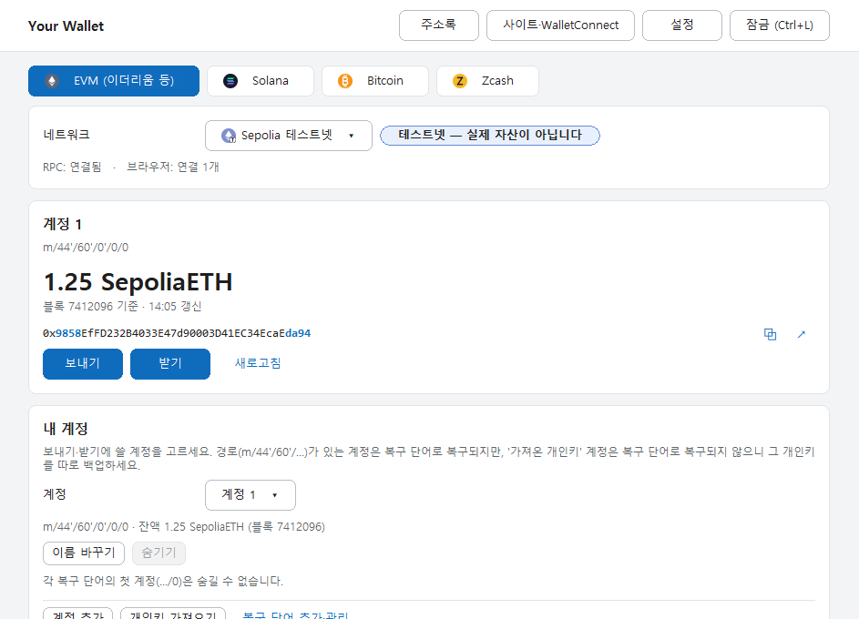
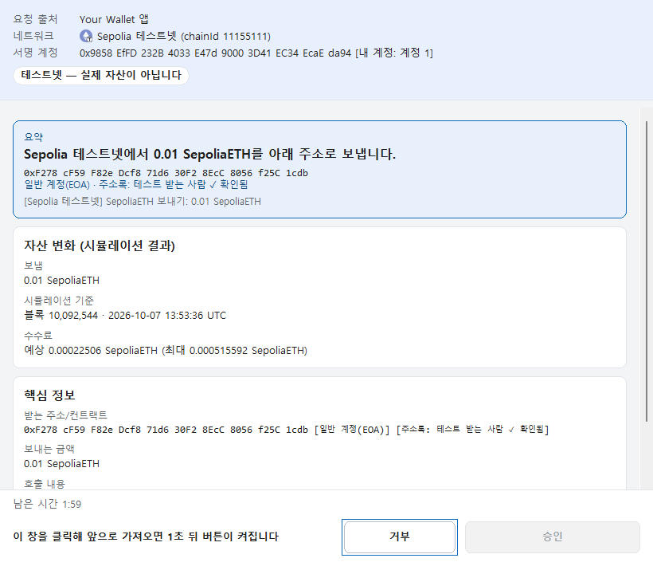
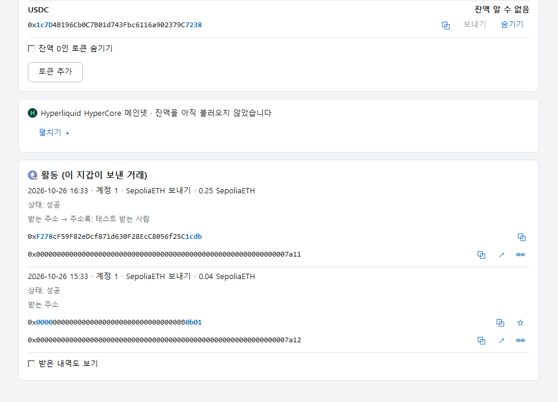
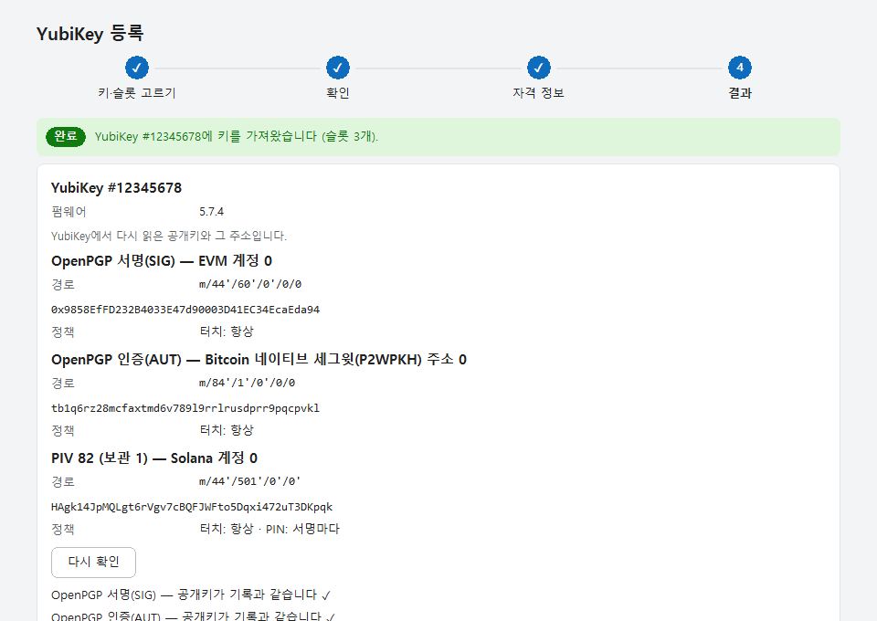
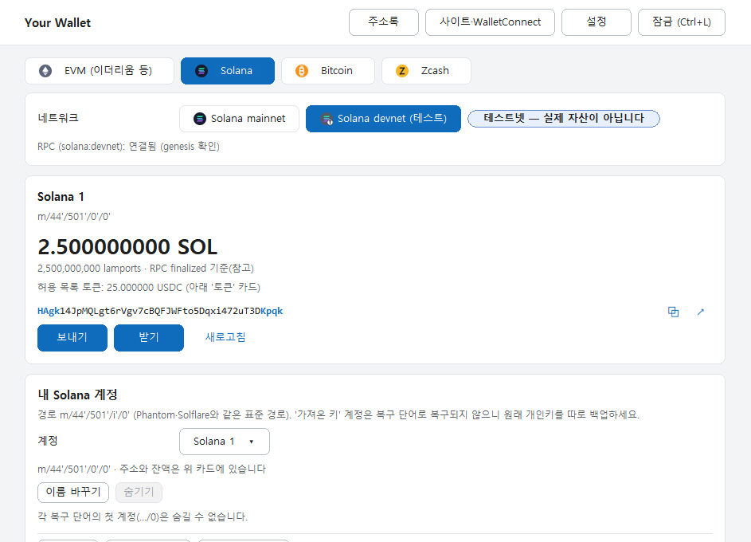
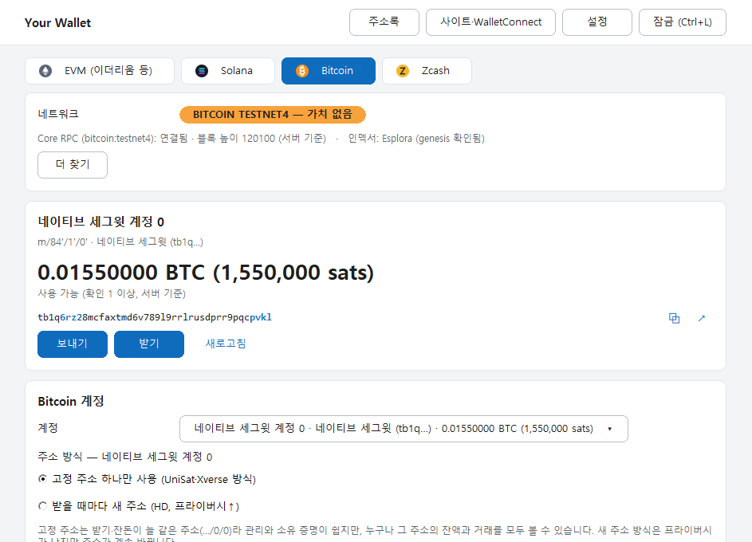

# Your Wallet

**한국어** · **[English](#english)**

Windows 11 PC 한 대에서 쓰는 개인용 멀티체인 지갑입니다. 키와 서명은 브라우저 밖의 데스크톱 앱이 맡고, Chrome 확장은
dApp 요청을 앱으로 전달만 합니다. 소스로만 공개하며, 각자 자기 PC에서 직접 빌드해 설치합니다.

<p align="center">
  
  
</p>

> **상태:** 기능 구현 완료, 저장소 자동 검사(`scripts/check.ps1`) 전부 통과. 실제 네트워크 사용은 막 시작했으니
> 처음에는 소액으로 쓰세요. 미리 빌드한 실행 파일은 배포하지 않습니다.

## 왜 Your Wallet인가

| | 일반 브라우저 확장 지갑 | Your Wallet |
|---|---|---|
| 키가 있는 곳 | 브라우저 확장 저장소 | 브라우저 밖 데스크톱 앱의 암호화 vault, 또는 YubiKey 안 |
| 서명 화면 | 확장 팝업(사이트가 준 정보에 기대는 경우가 많음) | 별도 Windows 창 — 서명할 바이트를 앱이 직접 해석하고 시뮬레이션 |
| 하드웨어 보안 | 별도 하드웨어 지갑 필요 | YubiKey 5 하나로 EVM·Bitcoin·Zcash·Solana 서명 |
| 체인 | 보통 한 생태계 | EVM 7개 + 직접 추가, Solana, Bitcoin(4가지 주소 형식), Zcash, HyperCore |
| 배포·검증 | 스토어 바이너리 | 소스만 — 직접 빌드, 의존성 고정, 확장은 npm 패키지 0개 |

**1. 키가 브라우저와 분리됩니다.** Chrome 확장에는 비밀이 하나도 없습니다. 웹페이지나 다른 확장이 문제를 일으켜도
키·니모닉에는 닿을 수 없고, 서명은 앱의 별도 창에서만 일어납니다.

**2. 보이는 그대로 서명합니다.** 승인 창은 사이트가 보낸 설명 대신, 서명할 데이터를 앱 코어가 직접 해석한 결과를
보여줍니다. 시뮬레이션으로 자산 변화를 미리 보여주고, 무제한 승인·permit·드레이너 패턴·비슷한 주소·로그인 메시지의
도메인 불일치를 경고합니다. 승인 버튼은 창이 앞에 온 뒤 1초가 지나야 켜지고(클릭 유도 방어), 위험한 요청은
2초 눌러야 승인됩니다. 승인은 그 요청 하나에만 묶여 다른 요청에 재사용할 수 없습니다.

**3. 하드웨어 지갑 없이 하드웨어급 보안.** YubiKey 5를 쓰면 개인키가 카드 밖으로 나오지 않고, 서명할 때마다 PIN과
터치를 요구합니다. 같은 키를 여러 장의 YubiKey에 넣어 서로의 백업으로 쓸 수 있습니다.

**4. 표준 복구.** BIP39 복구 단어와 표준 경로(BIP44/49/84/86, Solana `m/44'/501'`)를 쓰므로 다른 지갑에서도 같은
주소를 복구할 수 있습니다. 복구 단어를 여러 개 두거나 개인키만 가져와 쓸 수도 있습니다.

**5. 주소 오염·피싱 대비.**
- 주소록·내 계정과 앞뒤가 비슷한 주소를 경고합니다.
- 받는 주소를 대조하는 화면(승인·보내기·받기)은 4자리씩 끊어 전체를 보여줍니다.
- 받은 내역은 기본으로 꺼져 있습니다. 켜도 0원·먼지 입금은 숨기고, 보낸 사람 주소는 복사할 수 없습니다.

**6. 프라이버시.** 내가 고른 RPC(QuickNode·Alchemy 등)만 씁니다. 텔레메트리와 지갑 자체 서버가 없고, 로그에는
주소·키·금액을 남기지 않습니다.

**7. 기존 dApp과 호환.** 기본 모드(`Your Wallet (EVM)`·`Your Wallet (Solana)`) 외에 MetaMask·Rabby·Phantom·
UniSat·Xverse처럼 보이는 호환 모드가 있고, 확장 없이 WalletConnect v2(QR·링크)로도 연결합니다.

**8. 검토할 수 있는 규모.** 코드와 의존성을 한 사람이 검토할 수 있게 유지합니다. Rust 의존성은 `Cargo.lock`으로
고정하고 오프라인으로 빌드하며, 새 크레이트 추가는 검사 스크립트가 막습니다.

## 화면

<p align="center">
  
  
</p>
<p align="center">
  
  
</p>

모든 화면은 시험용 값입니다. 전체 화면 투어: [docs/screenshots](docs/screenshots/README.md).

## 기능

**체인**
- **EVM** — Ethereum, Arbitrum One, Base, BNB Smart Chain, Robinhood Chain, HyperEVM, Sepolia, 그리고 직접 추가한
  EVM 체인(처음 쓸 때 genesis 해시 고정). 네이티브 코인과 ERC-20 토큰(기본 목록 + 직접 추가, 숨기기),
  체인별 수수료 상한(Base L1 데이터 수수료 포함).
- **Solana** — SOL과 허용 목록의 USDC/USDT.
- **Bitcoin** — 네이티브 세그윗(`bc1q`, 기본), 탭루트(`bc1p`), 호환 세그윗(`3…`), 레거시(`1…`). 기본은 계정마다
  고정 주소 하나(UniSat·Xverse 방식), 원하면 받을 때마다 새 주소(HD).
- **Zcash** — 일반(transparent) 주소만. t-주소, TEX, 통합 주소(UA)의 일반 수신자로 보낼 수 있습니다.
- **HyperCore**(Hyperliquid) — 잔액, 전송, 현물↔선물, Arbitrum 출금, HyperEVM↔HyperCore 이동. 트레이딩은 없습니다.

**키**
- OS 난수로 24단어 생성과 백업 확인 퀴즈, 12–24단어 가져오기(passphrase 선택), 복구 단어 최대 8개.
- 개인키 가져오기(EVM hex, Solana base58/JSON, Bitcoin·Zcash WIF)와 개인키로만 시작하는 지갑.
- **YubiKey 5**(펌웨어 5.7+): EVM·Bitcoin·Zcash는 OpenPGP secp256k1, Solana는 PIV Ed25519. 복구 단어에서 키를 넣어
  여러 카드에 백업하거나 복구 단어 없이 카드를 연결. PIN 설정·슬롯 바꾸기·비우기를 앱에서 합니다.
- vault: Argon2id(256 MiB) + XChaCha20-Poly1305. 데이터 폴더는 현재 Windows 사용자만 접근합니다.

**서명과 dApp**
- 승인 창: 코어가 직접 해석한 내용, 시뮬레이션(`eth_simulateV1`), 위험 규칙, 1회용 승인, 1초 대기·2초 누르기.
- Chrome 확장: EVM은 EIP-1193/EIP-6963, Solana는 Wallet Standard, Bitcoin은 UniSat·Xverse 방식. Solana·Bitcoin dApp은
  연결과 **메시지 서명(소유 증명)만** 됩니다.
- WalletConnect v2(EVM): `wc:` 링크를 붙여넣거나 스크린샷의 QR을 읽어 연결.
- 선택 기능: AI가 요청을 설명(OpenAI·Claude·OpenRouter·로컬 모델, 내 API 키; 판단은 하지 않음).

**일상 기능**
- 주소·해시를 누르면 복사, 체인별 블록 탐색기 링크(설정에서 변경 가능), 받은 내역(선택).
- EVM 체인이 같이 쓰는 주소록과 즐겨찾기, 15초 잔액 갱신(창이 숨겨지면 멈춤).
- QuickNode 주소 하나로 모든 체인 RPC 설정, 지갑 초기화(파일을 지우지 않고 옆으로 옮김).

**하지 않는 것:** Windows 11 외 OS·모바일, 앱 안의 스왑·트레이딩, Solana·Bitcoin dApp의 거래 서명, Zcash 차폐 주소.
RPC는 직접 준비해야 합니다(QuickNode·Alchemy 무료 플랜으로 충분).

## 설치

준비: Windows 11 x64와 Chrome. 소스는 `git clone` 또는 GitHub **Code → Download ZIP**으로 받습니다.

1. 저장소 폴더의 **`install.cmd`** 를 더블클릭합니다. 소스를 빌드하고(처음에는 몇 분) `%LOCALAPPDATA%\Programs\YourWallet`에
   설치합니다(관리자 권한 불필요). Rust나 Visual Studio C++ 빌드 도구가 없으면 무엇이 없는지 보여 주고, 동의할 때만
   winget으로 설치합니다.
2. Chrome `chrome://extensions` → 개발자 모드 → **압축해제된 확장 프로그램 로드** →
   `%LOCALAPPDATA%\Programs\YourWallet\extension` 선택(경로는 설치 후 클립보드에 있고, 앱의 설정 → 브라우저·정보에도 안내가 있습니다).
3. 시작 메뉴에서 **Your Wallet**을 열고 지갑을 만들거나 가져온 뒤, 완료 화면에서 QuickNode 주소를 넣어 RPC를 연결합니다.

업데이트: `git pull` → `install.cmd` → 확장 카드의 새로고침. 제거: `uninstall.cmd`(지갑 데이터
`%LOCALAPPDATA%\YourWallet`은 남깁니다). 설치 스크립트가 저장소 폴더의 *Low* 무결성 레이블을 경고하면
`icacls "<저장소 폴더>" /setintegritylevel (OI)(CI)M`으로 지우거나, 알고 계속하려면 확인합니다.

실제 자산을 넣기 전에 [첫 사용 체크리스트](docs/first-use-checklist.ko.md)를 따르세요. 자세한 설치·문제 해결은
[docs/install.ko.md](docs/install.ko.md).

## 개발

전제([spec/01](spec/01-repo-build.md)): Windows 11 x64, rustup과 고정 툴체인(`rust-toolchain.toml`, Rust 1.95.0),
Visual Studio Build Tools(C++ 데스크톱 개발), Node.js 22+(검사용, npm 패키지 없음), Git, PowerShell 5.1 또는 7.

```powershell
cargo build --release --locked
powershell -NoProfile -ExecutionPolicy Bypass -File scripts/check.ps1 -Offline   # 저장소 게이트
```

게이트는 fmt, 의존성 허용 목록, clippy, 테스트, fuzz-lite, 빌드, 확장·스크립트 테스트, 개인정보 검사, 확장 정적 감사,
아이콘 검사를 차례로 실행합니다. `cargo update`는 쓰지 않고 새 크레이트는 더하지 않습니다.

## 보안 범위

방어 대상과 비목표는 [spec.md](spec.md) §2에 있습니다. 내 Windows 사용자 권한으로 도는 악성코드나 관리자·커널 장악은
범위 밖입니다 — PC가 장악되면 지갑도 장악된 것으로 봅니다(YubiKey를 쓰면 키 자체는 PC 밖에 남습니다). 범위 안: 보이는
것과 다른 서명, 악성 사이트와 WalletConnect 상대, 같은 PC의 다른 사용자, 키 분실, 버전 간 데이터 손실. 설정한 RPC
공급자는 신뢰합니다.

## 문서

| 문서 | 내용 |
|---|---|
| [spec.md](spec.md) | 목표, 위협 모델, 결정 사항, 아키텍처 |
| [spec/](spec/) | 01 저장소·빌드 · 02 키·vault · 03 EVM · 04 앱 UI · 05 브라우저 · 06 AI 설명 · 07 Solana · 08 Bitcoin · 09 테스트 · 10 YubiKey · 11 HyperCore · 12 Zcash · 13 WalletConnect |
| [docs/install.ko.md](docs/install.ko.md) | 설치·업데이트·제거, 첫 실행, 파일 위치, 문제 해결 |
| [docs/first-use-checklist.ko.md](docs/first-use-checklist.ko.md) | 첫 실제 사용 체크리스트 |
| [docs/recovery-guide.ko.md](docs/recovery-guide.ko.md) | 백업·복구 안내 |
| [docs/screenshots/](docs/screenshots/README.md) | 화면 투어(시험용 값) |
| [docs/security-review-20261101.md](docs/security-review-20261101.md) | 보안 검토와 처리 결과 |
| [docs/ux-review-20261109.md](docs/ux-review-20261109.md) | 최근 UI/UX 검토 |
| [docs/android-feasibility-20261107.md](docs/android-feasibility-20261107.md) | Android 이식 타당성(조사만, 계획 없음) |

---

## English

[↑ 한국어](#your-wallet)

A personal multi-chain wallet for one Windows 11 PC. Keys and signing live in a desktop app outside the browser; the
Chrome extension only forwards dApp requests to it. Published as source only — you build and install it yourself.

> **Status:** feature-complete and passing the full repository gate (`scripts/check.ps1`). Real-network use has just
> started, so start with small amounts. No prebuilt binaries are published.

### Why Your Wallet

| | Typical browser-extension wallet | Your Wallet |
|---|---|---|
| Where keys live | Browser extension storage | Encrypted vault of a desktop app outside the browser, or inside a YubiKey |
| Signing screen | Extension popup (often relies on what the site supplies) | A separate Windows window — the app decodes the exact bytes and simulates them |
| Hardware security | Needs a separate hardware wallet | One YubiKey 5 signs for EVM, Bitcoin, Zcash and Solana |
| Chains | Usually one ecosystem | 7 EVM chains + your own, Solana, Bitcoin (4 address types), Zcash, HyperCore |
| Distribution | Store binary | Source only — you build it; pinned dependencies; zero npm packages in the extension |

**1. Keys are separated from the browser.** The Chrome extension holds no secret at all. A malicious page or another
extension can't reach keys or the recovery phrase, and signing happens only in the app's own window.

**2. You sign what you see.** Approval windows show what the app's core decoded from the data being signed, never
the site's own description. A simulation previews the balance changes, and risk rules flag unlimited approvals,
permits, drainer patterns, look-alike addresses and sign-in domain mismatches. The approve button arms only a second
after the window comes to the front (click-jacking defence), risky requests need a 2-second hold, and each approval is
bound to that one request.

**3. Hardware-grade security without a hardware wallet.** With a YubiKey 5 the private keys never leave the card, and
every signature needs the PIN and a touch. The same keys can go on several cards as backups of each other.

**4. Standard recovery.** BIP39 phrases and standard paths (BIP44/49/84/86, Solana `m/44'/501'`) mean other wallets
recover the same addresses. Several recovery phrases and key-only accounts are supported.

**5. Address-poisoning and phishing defences.**
- Addresses that look like an address-book entry or one of your accounts are flagged.
- Screens where you check a recipient (approval, send, receive) show the full address in 4-character groups.
- Received history is off by default. When on, zero-value and dust deposits are hidden and senders can't be copied.

**6. Privacy.** Only the RPC provider you choose (QuickNode, Alchemy, …) is contacted. There is no telemetry and no
wallet server, and logs never contain addresses, keys or amounts.

**7. Works with existing dApps.** Besides the default names (`Your Wallet (EVM)`, `Your Wallet (Solana)`) there are
compatibility modes that look like MetaMask, Rabby, Phantom, UniSat or Xverse, and WalletConnect v2 (QR or link)
without the extension.

**8. Small enough to review.** Code and dependencies are kept reviewable by one person. Rust dependencies are pinned in
`Cargo.lock` and built offline; a check script blocks new crates.

### Screenshots

See the images above and the full [screen tour](docs/screenshots/README.md) (Korean UI, test values only).

### Features

**Chains**
- **EVM** — Ethereum, Arbitrum One, Base, BNB Smart Chain, Robinhood Chain, HyperEVM, Sepolia, plus any EVM chain you
  add (genesis hash pinned on first use). Native coins and ERC-20 tokens (built-in list + your own, hide/show), per-chain
  fee caps (Base L1 data fee included).
- **Solana** — SOL and allow-listed USDC/USDT.
- **Bitcoin** — native segwit (`bc1q`, default), taproot (`bc1p`), nested segwit (`3…`) and legacy (`1…`); one fixed
  address per account by default (UniSat/Xverse style) or a new address per receive (HD).
- **Zcash** — transparent addresses only (send to t-addr, TEX and the transparent receiver of a unified address).
- **HyperCore** (Hyperliquid) — balances, transfers, spot↔perp, withdraw to Arbitrum, HyperEVM↔HyperCore moves. No trading.

**Keys**
- 24-word generation from the OS RNG with a backup quiz; import 12–24 words with an optional passphrase; up to 8 phrases.
- Private-key import (EVM hex, Solana base58/JSON, Bitcoin and Zcash WIF) and key-only wallets.
- **YubiKey 5** (firmware 5.7+): OpenPGP secp256k1 for EVM/Bitcoin/Zcash, PIV Ed25519 for Solana. Enrol keys from
  your words onto one or more cards, or connect a card without words. PIN setup, slot switching and clearing are built in.
- Vault: Argon2id (256 MiB) + XChaCha20-Poly1305; the data folder is locked to the current Windows user.

**Signing and dApps**
- Approval windows: the core's own decoding, simulation (`eth_simulateV1`), risk rules, one-shot approvals, 1 s arm
  delay and 2 s hold.
- Chrome extension: EIP-1193/EIP-6963 for EVM, Wallet Standard for Solana, UniSat/Xverse styles for Bitcoin. Solana and
  Bitcoin dApps can connect and request **message signatures only** (proof of ownership).
- WalletConnect v2 (EVM): paste a `wc:` link or read the QR from a screenshot.
- Optional AI explanation of a request (OpenAI, Claude, OpenRouter or a local model, your own API key; it never decides).

**Everyday**
- Click an address or hash to copy it, per-chain block-explorer links (changeable in settings), optional received history.
- An address book shared by all EVM chains, favourites, balances refreshed every 15 s (paused while the window is hidden).
- RPC for every chain from one QuickNode URL; wallet reset that moves files aside instead of deleting them.

**Not included:** other OSes or mobile, swaps or trading inside the app, transaction signing for Solana/Bitcoin dApps,
Zcash shielded addresses. You bring your own RPC (QuickNode or Alchemy free plans are enough).

### Install

Requirements: Windows 11 x64 and Chrome. Get the source with `git clone` or GitHub **Code → Download ZIP**.

1. Double-click **`install.cmd`** in the repository folder. It builds from source (a few minutes the first time) and
   installs to `%LOCALAPPDATA%\Programs\YourWallet` — no administrator rights needed. If Rust or the Visual Studio C++
   build tools are missing it says so and installs them with winget only if you agree.
2. In Chrome open `chrome://extensions`, turn on Developer mode, choose **Load unpacked** and select
   `%LOCALAPPDATA%\Programs\YourWallet\extension` (the path is on the clipboard after installing; Settings → 브라우저·정보
   in the app has the same guide).
3. Start **Your Wallet** from the Start menu, create or import a wallet, and paste a QuickNode URL on the finish screen.

Update: `git pull` → `install.cmd` → reload the extension card. Uninstall: `uninstall.cmd` (wallet data in
`%LOCALAPPDATA%\YourWallet` is kept). If the installer warns about a *Low* integrity label on the repository folder,
remove it with `icacls "<repo folder>" /setintegritylevel (OI)(CI)M` or confirm to continue.

Before using real funds, follow the short [first-use checklist](docs/first-use-checklist.ko.md) (Korean).

### Development

Prerequisites ([spec/01](spec/01-repo-build.md)): Windows 11 x64, rustup with the pinned toolchain
(`rust-toolchain.toml`, Rust 1.95.0), Visual Studio Build Tools (C++ desktop workload), Node.js 22+ (checks only, no npm
packages), Git, PowerShell 5.1 or 7.

```powershell
cargo build --release --locked
powershell -NoProfile -ExecutionPolicy Bypass -File scripts/check.ps1 -Offline   # the repository gate
```

The gate runs fmt, the dependency allowlist, clippy, tests, fuzz-lite, build, extension and script tests, a privacy
scan, the extension static audit and the icon check. Never run `cargo update`; new crates are not added.

### Security model

What is and isn't defended is in [spec.md](spec.md) §2. Malware running as your Windows user, or an administrator/kernel
compromise, is out of scope — if the PC is compromised the wallet is too (a YubiKey still keeps the keys themselves off
the PC). In scope: signing something other than what is shown, malicious sites and WalletConnect peers, other users on
the PC, key loss, and data loss across versions. The configured RPC provider is trusted.

### Documents

The specs and docs listed in the Korean [문서](#문서) table above are in Korean: `spec.md` and `spec/` (01–13), install,
first-use checklist, recovery guide, screen tour, security and UX reviews.
